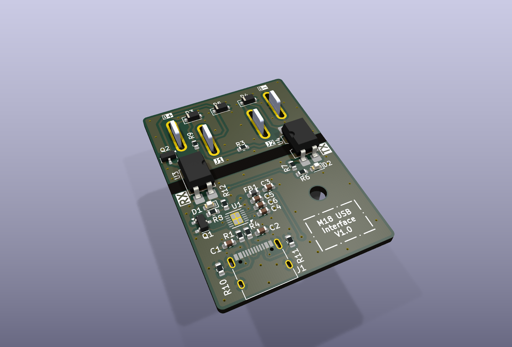
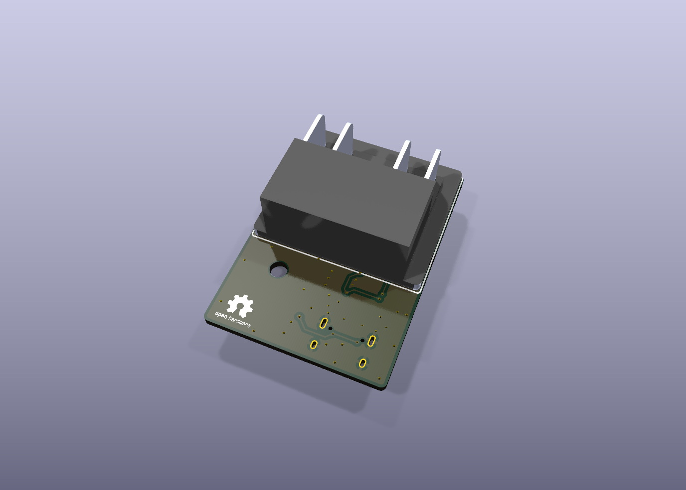
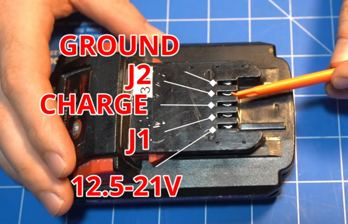
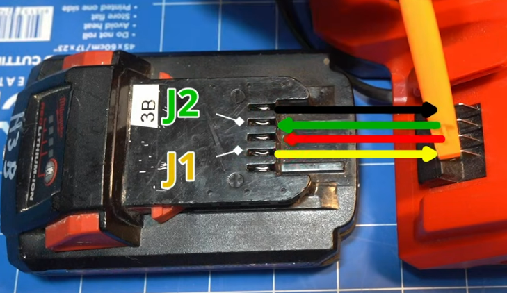
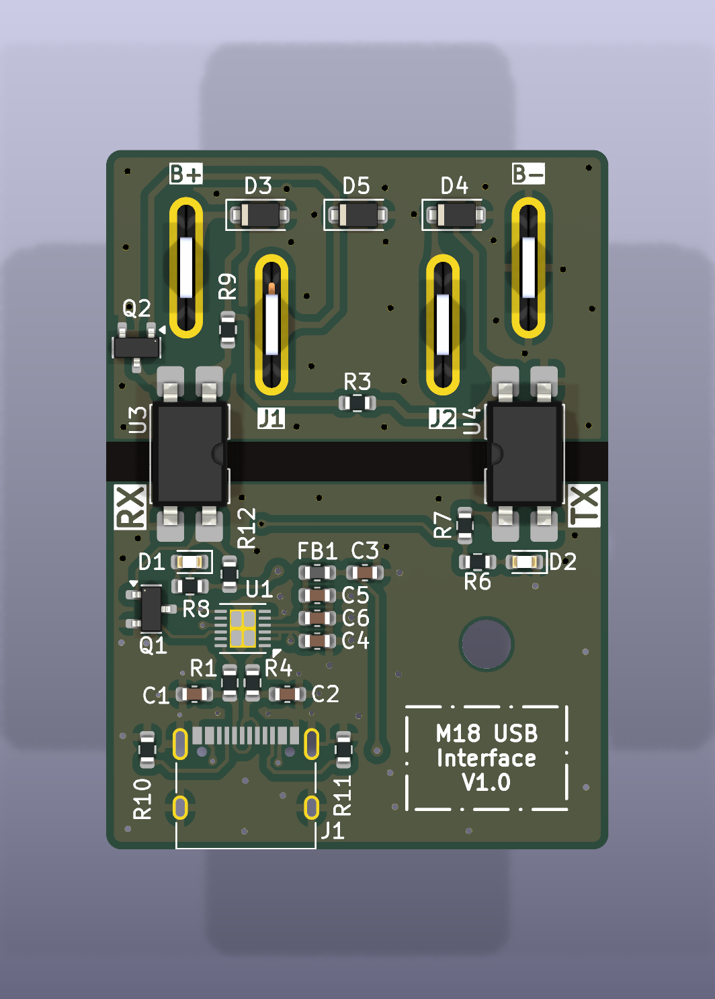

# M18 USB Interface

A USB-C board that plugs into a Milwaukee M18 battery so a PC can talk to the pack's diagnostic pins.



Revision v1.0. The M18 connector is on the back of the board.



## Companion software

Read a health report, cell data, and charge history with [m18-protocol-rs](https://github.com/fred314159265/m18-protocol-rs):

```bash
cargo run --example health_report -- COM3
```

On Linux or macOS, pass the serial device instead, for example `/dev/ttyUSB0`.

The protocol comes from the reverse engineering in [mnh-jansson/m18-protocol](https://github.com/mnh-jansson/m18-protocol). That Python tool works with this board as well.

## Features

- USB-C and an FT234XD serial bridge, with RX and TX LEDs.
- Two LTV-817S optocouplers. The battery UART is on its own ground, separate from the PC.
- J2 is driven as a roughly 0–12 V signal, which is what the pack expects. J1 comes back from the pack at about 3.3–5 V.
- ESD diodes on the exposed battery pins.
- Everything except the M18 connector is chosen from the JLCPCB assembly library. Solder the connector on afterwards.
- KiCad 9 sources. The v1.0 fabrication package is in the repo and on the [v1.0 release](https://github.com/fred314159265/m18-usb-interface/releases/tag/v1.0).

## Battery pins

These photos are from the [Tool Scientist](https://www.youtube.com/watch?v=tHj0-Gzvbeo) video and the [m18-protocol hardware notes](https://github.com/mnh-jansson/m18-protocol#hardware). They show the pack terminals this board connects to.

| Pin | Role | Level |
| --- | --- | --- |
| B+ | Pack positive | About 12.5–21 V |
| J1 | Output from the pack | About 3.3–5 V |
| C | Charge terminal | |
| J2 | Input to the pack | About 0–12 V |
| B− | Pack negative | |






`Images/wiring.png` is the discrete FTDI adapter and level shifter that this PCB replaces.

## One-time FTDI setup

The optocouplers invert TX and RX. Program the FT234XD once with [FT_Prog](https://ftdichip.com/utilities/#ft_prog), or the link will not decode.

Template: [`m18-usb-interface-pcb/Releases/v1.0/M18_Interface_FT_Prog_Template.xml`](m18-usb-interface-pcb/Releases/v1.0/M18_Interface_FT_Prog_Template.xml)

1. Install FT_Prog.
2. Choose `File → Open Template…` and select the template.
3. Plug in the board. Choose `Devices → Scan and Parse`.
4. Right-click the device, choose `Apply Template`, and select the template.
5. Choose `Devices → Program`.

The template writes:

- USB product name `M18 USB Interface`
- TX and RX inverted
- the VCP driver, so the board shows up as a normal COM port
- 8 mA drive, slow slew, and Schmitt trigger inputs

## Build

Fabrication files for v1.0:

- [Release v1.0](https://github.com/fred314159265/m18-usb-interface/releases/tag/v1.0), with the gerber zip, schematic PDF, and FT_Prog template attached
- Gerbers and assembly files in [`m18-usb-interface-pcb/Releases/v1.0/production/`](m18-usb-interface-pcb/Releases/v1.0/production)
- [Schematic PDF](m18-usb-interface-pcb/Releases/v1.0/m18-usb-interface-pcb_v1.0.pdf)
- [Interactive BOM](https://fred314159265.github.io/m18-usb-interface/m18-usb-interface-pcb/bom/ibom.html)



1. Order the board from the production zip. It includes the gerbers, BOM, and pick-and-place file.
2. Solder on an M18 battery connector. The footprint matches common shells such as [this one](https://www.aliexpress.com/item/1005009824719494.html).
3. Program the FTDI chip with the template above.
4. Plug the board into an M18 pack, and plug USB-C into the PC.
5. Run `health_report` from [m18-protocol-rs](https://github.com/fred314159265/m18-protocol-rs).

## Safety

This is not a Milwaukee Tool product, and Milwaukee has not endorsed it. Lithium-ion packs can burn if they are shorted or wired wrong. Isolation on this board is not a guarantee if it is assembled incorrectly. Use it at your own risk.

## License

Public domain under [The Unlicense](LICENSE).

## Thanks

[Tool Scientist](https://youtu.be/tHj0-Gzvbeo) and the contributors to [m18-protocol](https://github.com/mnh-jansson/m18-protocol) documented the pins and the protocol this board is built for.
